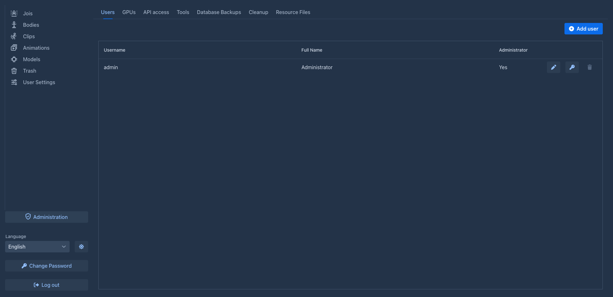
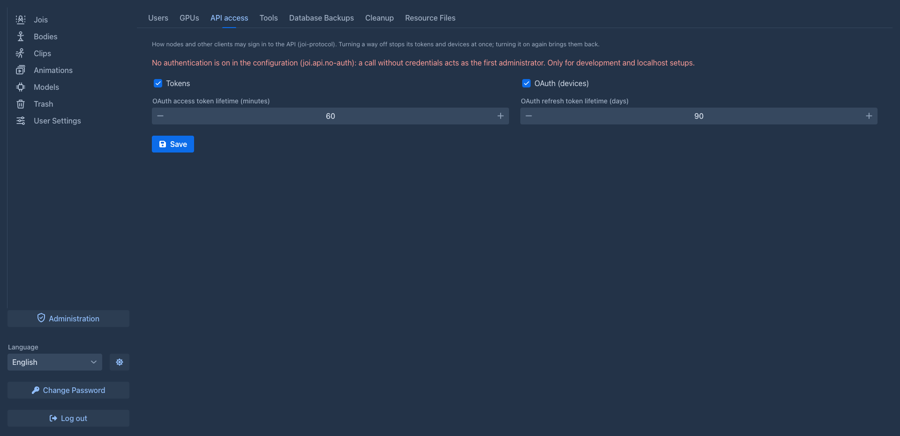
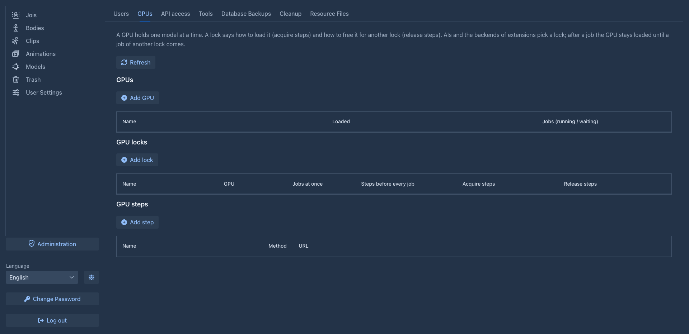
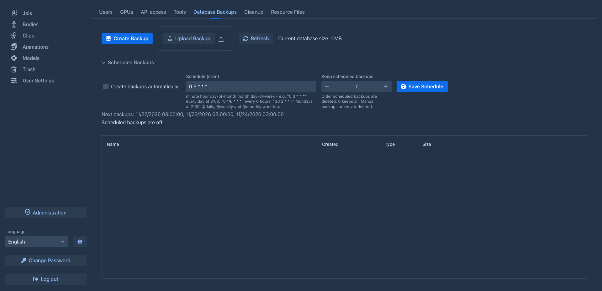

# Administration

Administrators have an **Administration** button under the tabs, which opens a page with these tabs:

| Tab | What it holds |
|---|---|
| **Users** | the accounts: user name, full name, whether administrator. **Add user**, edit, **Permissions**, delete. You cannot delete yourself |
| **GPUs** | GPU locks, below |
| **API access** | whether tokens and OAuth devices are offered, and their lifetimes. See [Access tokens](../access.md) |
| **Tools** | the administrator's permission for every server tool and the web search sources everyone gets. See [Server tools](../tools/index.md) |
| **Database Backups** | backups of the database |
| **Cleanup** | permanently removes deleted objects |
| **Resource Files** | the files of the data folder |

## GPU locks

A GPU holds one thing at a time. A **lock** says how to fill it: **acquire steps** run in order before the first job of the lock, **release
steps** run when a job of another lock needs the GPU (or with *Unload now*), and **steps before every job** run each time. Steps
call a server by HTTP; headers are stored encrypted, and a step can name `{{model}}` and `{{lock}}`. Text models and TTS models
choose a lock, and every request waits for its turn. The tab shows each GPU, its locks and the jobs running and waiting. The
jobs of one lock run side by side: a lock whose start-up loads the conversation model and the speech model keeps both loaded.

**The GPU is used outside**: tick it when other programs use the GPU too: the acquire steps then run before every job, and must make
room by themselves.

## Backups

**Database Backups** shows the database size and its backups. Create one by hand, set **Create backups automatically** with a
cron **Schedule** (`0 3 * * *` is every day at 3:00) and **Keep scheduled backups** (0 keeps all; manual backups are never deleted).
**Restore on restart** schedules a restore, applied when the application restarts.

## Cleanup

**Cleanup** permanently removes deleted objects that are no longer used anywhere, with the data that belongs only to them.
Deleted objects that are still referenced are kept. After it, [Trash](../trash.md) can no longer restore them. **Resource Files**
removes the files nothing uses.
