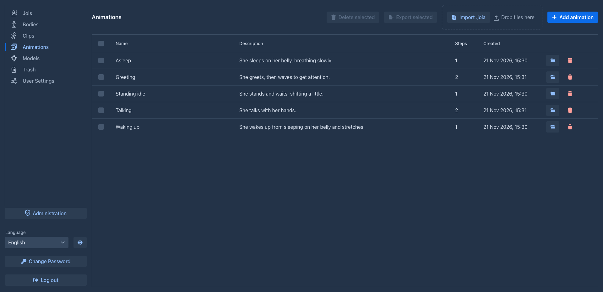
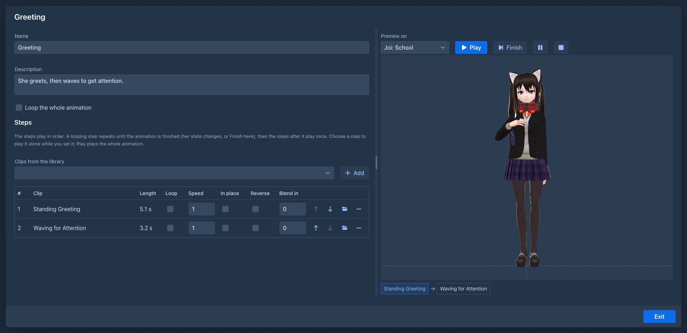
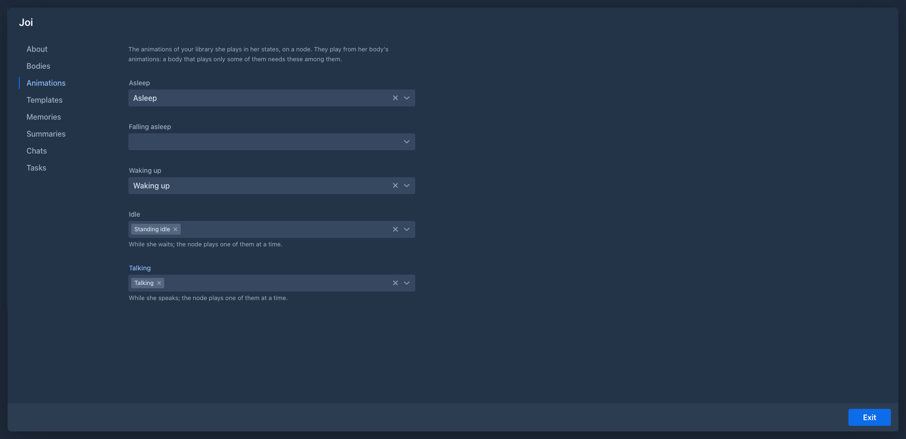

# Animations of an assistant

An animation is what she plays: a name, a description, its **steps** in order, whether the whole animation loops, and the body
it is previewed on.

## The animation dialog

**Add animation** (or **New animation of this clip** from a clip) opens the dialog. Under **Steps**, **Add** clips from the
library. Each step is a clip with how it plays there:

| Setting | Meaning |
|---|---|
| **Loop** | the step repeats until the animation is finished, then the steps after it play once |
| **Speed** | playing speed |
| **In place** | the clip does not move her from her spot |
| **Reverse** | the clip plays backwards: sitting down played back is standing up, so one clip serves both |
| **Blend in** | seconds of crossfade from the last frame of the step before, so two clips whose poses do not meet flow into each other |
| **Rotation of the step** | the whole clip turned around her hips where the step starts, for a clip made facing or lying another way. Set it in degrees around X, Y and Z, or turn it in the preview with the rings on her hips (**Rotate in the preview**); **No rotation** resets it |

These settings belong to the step; the clip is never changed. A clip can be in several animations and steps, and the clip's own
loop, speed and in-place are only what a new step starts from. Steps are moved up and down in the table, and removed with **Remove
the step**.

**Loop the whole animation** starts it again after its last step until it is finished: clips that do not loop on their own, a
wave and a nod, again and again.

**Eyes** and **Expression** set her face while the animation plays. **Her own** leaves them to her: her eyes follow what she does (shut while she
sleeps, open and blinking otherwise) and her mood shows as a soft expression. **Closed**, **Half closed** and **Wide open** (open, never
blinking) set her eyes; **Happy**, **Sad**, **Angry**, **Relaxed** and **Surprised** show that expression instead of her mood's. The preview shows them
at once. They need a model with the matching expressions (a model converted from a VRChat avatar has them): the eyes use its `blink`.

A step chosen in the table, or in the strip of steps under the preview (the step that plays is marked, with its rounds), plays
alone. **Play** plays the animation, **Finish** ends a looping step so the next ones play. "Jumping jacks" is a start once, the
jumps looping, a stop once. A clip added to an animation appends its description to the animation's, on a line of its own.

Deleting an animation keeps its clips.

## Roles in her dialog

The **Animations** tab of her dialog chooses, from your animations, what she plays asleep, falling asleep, waking up, idle and
talking. A node plays them from her body's `.joia`, so a body that plays only some animations needs these among them; one you
deleted is no longer chosen.

## Export and import

**Export selected** (on the Animations tab) downloads the checked animations with the clips they play, each clip once, as one
**`.joia`** file. **Import .joia** adds the file's animations as new ones.

Clips are linked by their id: a clip you already have is linked and its copy skipped; any other is added to the library, so
importing the same file again links it. A file that refers to a clip of another user is refused before anything is written.

Joi does not check licenses nor leave clips out of a file: what you share is up to you.
