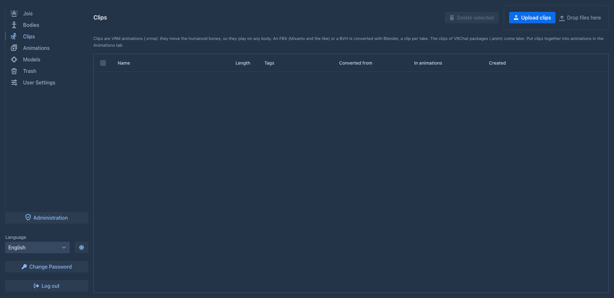

# Clips

The **Clips** tab is the library of motions.

## Uploading

**Upload clips** takes one or more files:

| File | How it is used |
|---|---|
| **VRMA** (VRM Animation) | as it is |
| **FBX** (for example from Mixamo) and **BVH** | converted on the server with Blender and the VRM add-on |

The conversion maps the skeleton to the humanoid bones (it knows Mixamo, Unreal, Biped, VRoid, MMD and others, and guesses from
the shape of the skeleton) and writes each take as a VRMA against a T-pose. One Blender runs at a time, together with the model
conversions. Hips that rest at the floor, as in most BVH files, get the first frame's position as their rest.

The rest pose matters: an FBX with no mesh has no bind pose, so its rest is whatever pose it was written in. If that is not a
T-pose or close to one (an A-pose), the limbs are straightened by direction only and a twist of the forearm is lost.

A clip keeps its name, description, tags, the length, the bones it moves, whether it moves expressions, and what it was converted
from (the FBX or BVH and the take).

## The list and the clip dialog

The tab lists the clips with checkboxes and **Delete selected**. Open one to see it in the clip dialog: it plays in a loop on the
body you pick under **Preview on** (in that body's state of parts). Edit its name, description, tags and loop. **New animation of
this clip** makes an animation out of it, named after it.

The description is for you and for her: she picks an animation by what it says.

Deleting a clip takes it out of the animations that use it.
