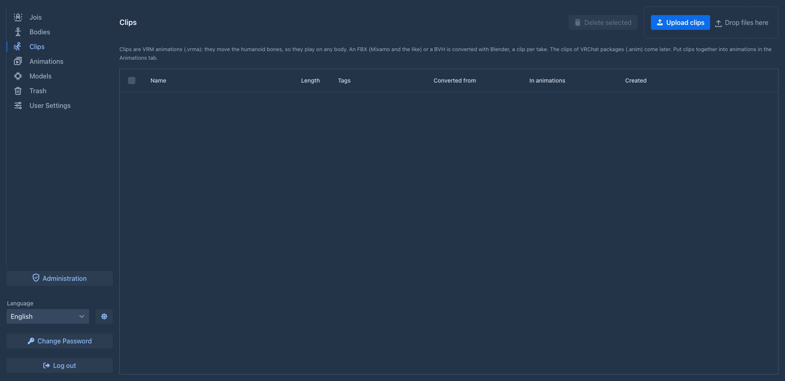
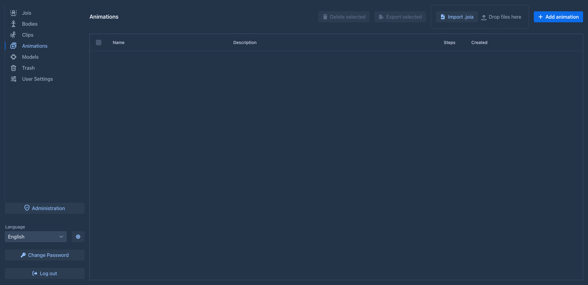

# Animations

She moves with animations from your library. There are two layers, and two workspace tabs for them:

- **Clips** are single motions: a wave, a nod, a sitting down. You upload them (VRMA, FBX or BVH). A clip alone does nothing.
  See [Clips](clips.md).
- **Animations** are what she plays: one or more clips as steps, each with its own loop, speed, direction and blend. See
  [Animations of an assistant](animations.md).

The library is shared by all your bodies and assistants: a clip made for one humanoid body plays on all of them, because the
viewer retargets it to the rig of the body. Both tabs can be previewed on any body of yours.

## When an animation plays

In her dialog's **Animations** tab you choose which animations she plays in her states on a node:

| State | When |
|---|---|
| **Asleep** | before her first waking up; loops |
| **Falling asleep** | when she goes to sleep |
| **Waking up** | when she wakes |
| **Idle** | while she waits: a list, one is played at a time, another each time |
| **Talking** | while she speaks: a list, one at a time |

She can also play an animation herself, with her function `play_animation`, whenever she likes to: before or while she speaks.
Her prompt asks her to do it often and not to repeat the last one. The node plays it once on top of her state. If she starts
talking while it plays, her talking animation waits for its end.

The body decides which animations she has: see [Bodies of an assistant](../bodies/bodies.md) (**Her animations**).
