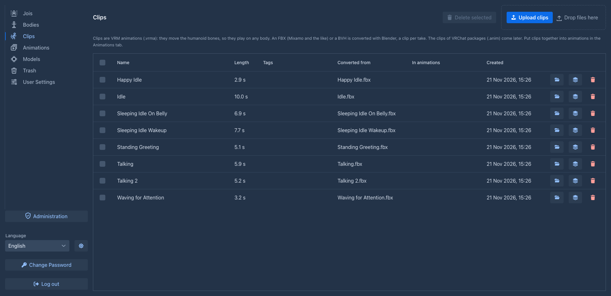

# Animations

She moves with animations from your library. There are two layers, and two workspace tabs for them:

- **Clips** are single motions: a wave, a nod, a sitting down. You upload them (VRMA, FBX or BVH). A clip alone does nothing.
  See [Clips](clips.md).
- **Animations** are what she plays: one or more clips as steps, each with its own loop, speed, direction and blend. See
  [Animations of an assistant](animations.md).

Both tabs keep their items in [folders](#folders), nested as deep as you like. The library is shared by all your bodies and assistants: a clip made for one humanoid body plays on all of them, because the
viewer retargets it to the rig of the body. Both tabs can be previewed on any body of yours.

## Folders

The clips and the animations each have folders of their own, as books have in Marginalia. Above the table is the path of the
folder you are in: the tab's name (the top level), then each folder above it, which you click to go back up. The folders in the
folder open are the first rows of the table; click a folder's name (or double-click its row) to open it.

- **New folder** makes a folder in the folder open. Two folders of one folder can't have the same name (whatever the case), and a
  name has no slash.
- A folder's buttons **rename** it, **move** it (with all that is in it) into another folder or the top level, and **delete** it.
  An empty folder is deleted after a confirmation. For one with something in it you choose: **move what is in it to the folder
  above** (the default), or **delete all of it**, which asks again with the numbers. Clips deleted so leave their animations;
  animations deleted so keep their clips.
- **Move to a folder** on a row, or on the rows checked, puts clips or animations into another folder.
- A clip uploaded (or converted), an animation added, and the animations of an imported `.joia` go into the folder open.

Everywhere you choose a clip or an animation (a clip for a step, her roles, a body's animations), it is shown with the path of
its folder before its name, as **Idle / Standing / Breathe**, and the choices are sorted by that path.

## When an animation plays

In her dialog's **Animations** tab you choose which animations she plays in her states on a node:

| State | When |
|---|---|
| **Asleep** | before her first waking up; loops |
| **Falling asleep** | when she goes to sleep |
| **Waking up** | when she wakes |
| **Idle** | while she waits: a list, one is played at a time, another each time |
| **Talking** | while she speaks: a list, one at a time |

She can also play an animation herself, with her function `play_animation`, whenever she likes to: before or while she speaks. Her
face has its own function, `set_expression`: she shows one of her model's expressions for a few seconds (see [The JavaFX node](../node/javafx.md)).
Her prompt asks her to do it often and not to repeat the last one. The node plays it once on top of her state. If she starts
talking while it plays, her talking animation waits for its end.

The body decides which animations she has: see [Bodies of an assistant](../bodies/bodies.md) (**Her animations**).
