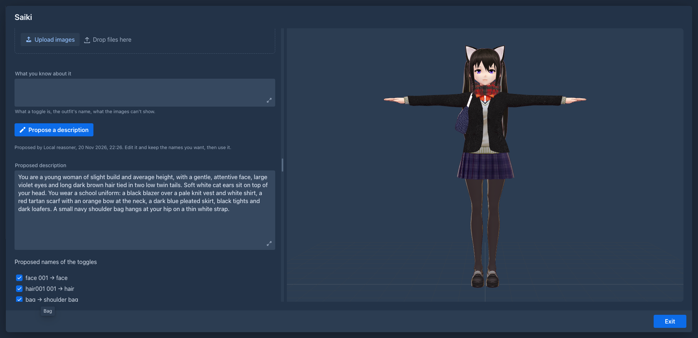
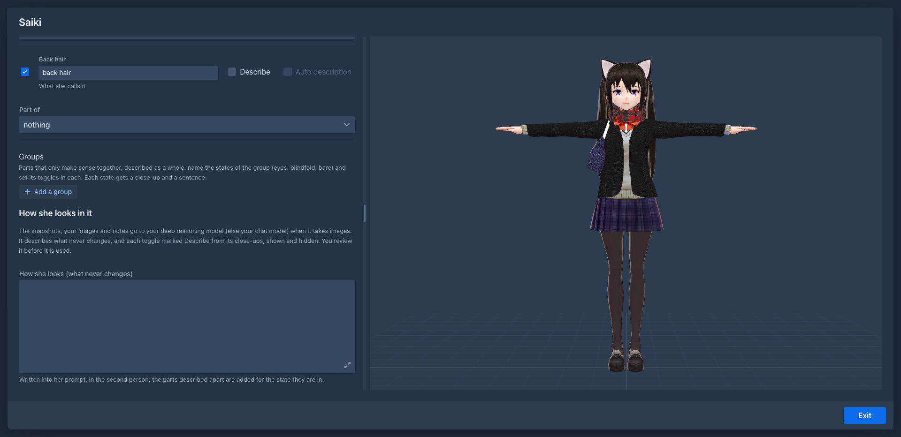
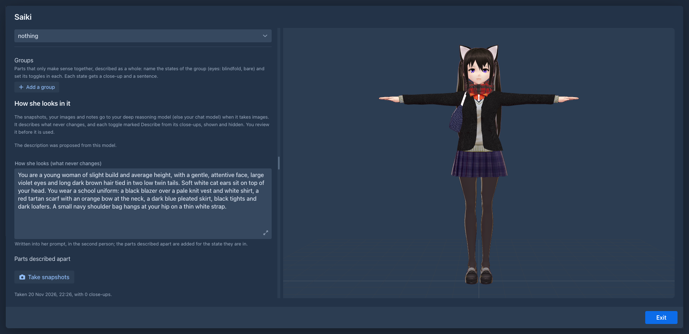

# Appearance

For her to know how she looks, the model has a description. You write it yourself, or a multimodal model proposes it from
pictures and you review it. The description belongs to the model, so every body of the model shares it.

It is on the model's dialog, once the model has a VRM.

## The steps

1. **Take snapshots.** The viewer renders six shots of the whole model (full body front, three-quarter, profile and back, and
   the face front and three-quarter) in the model's default state, plus a close-up of every part described apart in each of
   its states. They are stored with the model, and the dialog says when they were taken and that they are out of date after the
   model changes.
2. **Add what you know.** **Upload images** adds your own pictures (PNG, JPEG, WebP: a store page, photos, renders). **What you
   know about it** takes notes: what a toggle is, what the images cannot show.
3. **Propose a description.** The snapshots, your images and notes go to your deep reasoning model when it takes images, else your
   chat model. It writes the description of the model as the renders show it, proposes a name for each toggle, and then
   describes each part apart with a sentence per state. A progress line shows what it is doing.
4. **Review.** You edit the description, keep or drop each proposed name and each part's sentences, then press **Use it**, or
   **Discard**. The description and the sentences stay editable afterwards.

Your multimodal model is set up in [Text models](../models/text-models.md). The prompts it is given are templates you can change
(see [Persona and personality](../jois/persona.md)).

The dialog remembers what the description was made from: when the model changes it says the snapshots and the description are
out of date. Using a new description is an event for every assistant that has a body of the model.

## Parts described apart

Only parts that have words can be switched by her. On each toggle row:

- **Described** (the **Describe** box): the part is described apart, shown and hidden, from close-ups. Her description follows the
  part when it is switched, and she can switch it. Until you choose, the shape key toggles are described.
- **Shown by default**: whether the part is shown by default. The preview and the snapshots show the model so.
- **Auto description**: marks the part as a layer of her look (clothes, an accessory). The shots of the whole model are taken
  with the layers off, so her description is of the bare model, and every layer she wears adds its sentence.

The default state is the baseline: the description has every part in it, and the other states are news ("The visor is gone:
your eyes are pale grey").

## Toggle groups

Parts that only make sense together are described as a whole. Under **Groups**, **Add a group**, name it ("eyes"), and **Add a
state** for each combination ("blindfold": the band shown; "bare": the band hidden and the iris shown), with a box per toggle and a
button that shows the state on the preview. Each state gets a close-up of the whole group and a sentence. Mark the group's
**default** state: the least covered one reads best.

A toggle is in one group at most. A described toggle in no group is a part of its own, with the states shown and hidden.

## What she is told

Her look is the description plus the sentence of every part off its default. It is in her prompt, in the event when she changes
body, and in what the switch of a part answers. The parts she can switch are listed in her prompt under the names you gave.

