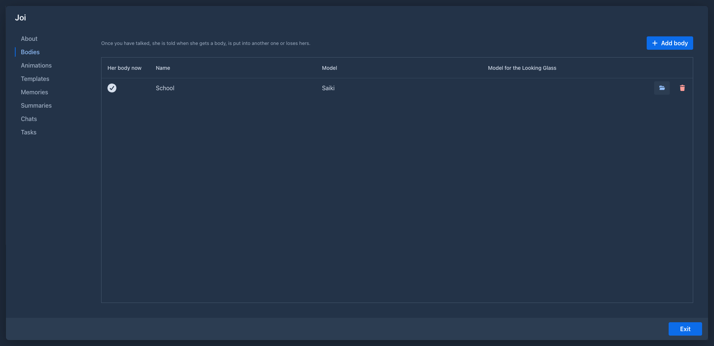
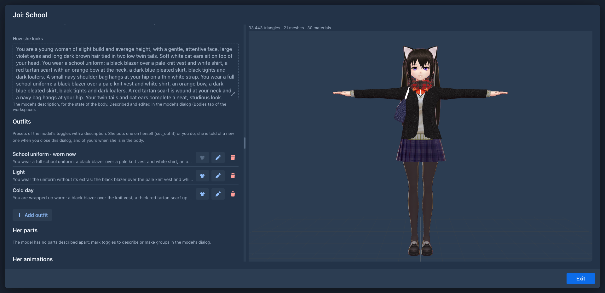

# Bodies of an assistant

In her dialog the **Bodies** tab lists the bodies of this assistant: her body now, the name, the models, and for each one **Put her
into this body**, **Open** and **Delete**. **Add body** makes a new one.

The first body she gets becomes active. She can only switch between the bodies on her list.

## The body dialog

| Part | Meaning |
|---|---|
| **Name**, **Description** | the description is what she reads of this body in her list of bodies; blank uses the model's |
| **Model** | the full model. Only models with a VRM are offered (converted, or uploaded as `.vrm` or `.glb`) |
| **Model for the Looking Glass** | a lighter model for the Looking Glass; **The same model** is the default |
| **How she looks** | the model's description for the body's state, read only: edit it in the model's dialog |
| **Her parts** | a choice per part described apart: a group's states, or shown and hidden. The default is marked |
| **Outfits** | see [Outfits](outfits.md) |
| **Her animations** | see [Animations of an assistant](../animations/animations.md) |

The preview shows either the **Full model** or the **Looking Glass** one, in the state of her parts.

## Her parts

Switching a part changes how she looks. The state is stored on the body, and is the same at the next start and on every node.
When she is in this body and has chatted, she is told (`body.part_switched`): "A part of you was switched: eyes, now
'blindfold'", with the state's sentence, and what went with it ("With it, golden halo is gone from sight too"). Changes made
in quick succession are one event.

She can also switch her parts herself, with `change_body_part`, when she decides to or agrees to what you ask. She can only
switch parts that are described apart, by the names you gave them. The answer says how she looks now.

## When she is told

Once you have talked, she is told when she gets her first body, is put into another one, or loses hers (the body she is in was
deleted).
