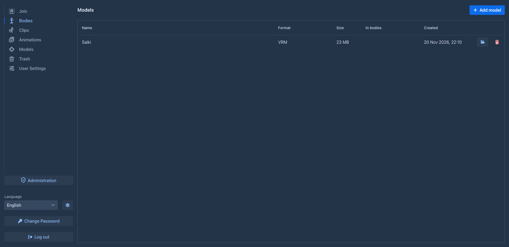

# Bodies

Her body is a 3D model that a node draws next to the chat, or on a Looking Glass. Three things fit together:

- A **model** is a 3D file of yours, converted to VRM, with what it can do (expressions, parts that can be hidden, bones) read
  from it and a description of how it looks. Models live in the **Bodies** tab of the workspace. See [Models](models.md).
- A **body** belongs to one assistant and is made of your models. One of her bodies is active: the one she is in. It keeps the
  state of her parts and her outfits. See [Bodies of an assistant](bodies.md).
- An **outfit** is a preset of the model's parts with a description. See [Outfits](outfits.md).

How she looks is the model's, not the body's: every body of a model, of any of your assistants, looks the same and shares the
description you write once in the model's dialog. See [Appearance](appearance.md). How the model moves is set in
[Spring bones](spring-bones.md) and the [animations](../animations/index.md) she plays.

## What you bring

Users bring their own avatars. Joi checks no licenses: what you upload and what you share is up to you.

## Where the files live

Everything is stored in your data folder as resources of your account: the upload you made, the converted VRM, the snapshots
and your images, and the exported files.

| File | What it is |
|---|---|
| **VRM** | the converted model. A `.vrm` or `.glb` you upload is used as it is |
| **`.joim`** | "Joi model": one file with the VRM and everything decided on it: toggle names, description, groups, default state, spring bones, notes, conversion settings. Importing it gives a ready model with no conversion |
| **`.joia`** | "Joi animations": animations with their clips. A body has one of its own |

Nodes download the `.joim` and `.joia` of her active body and keep them by hash, so a switch of body is instant.
