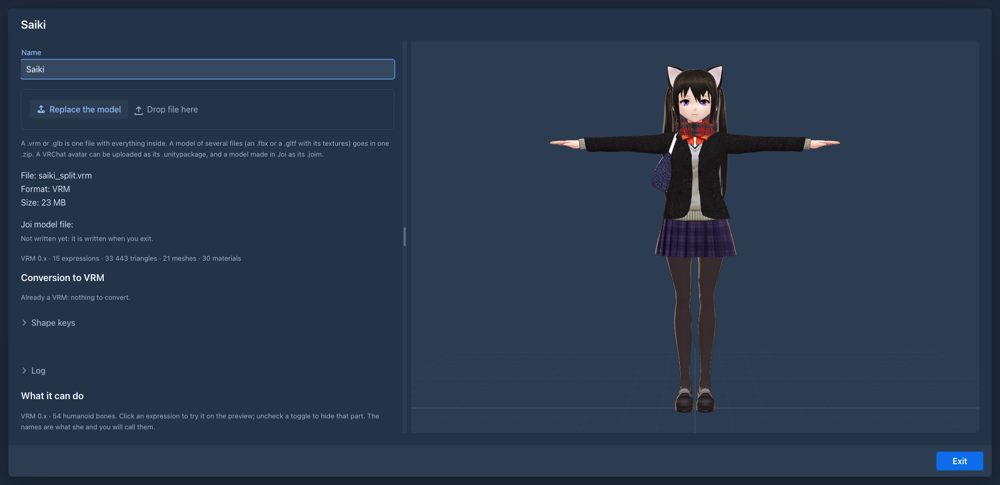
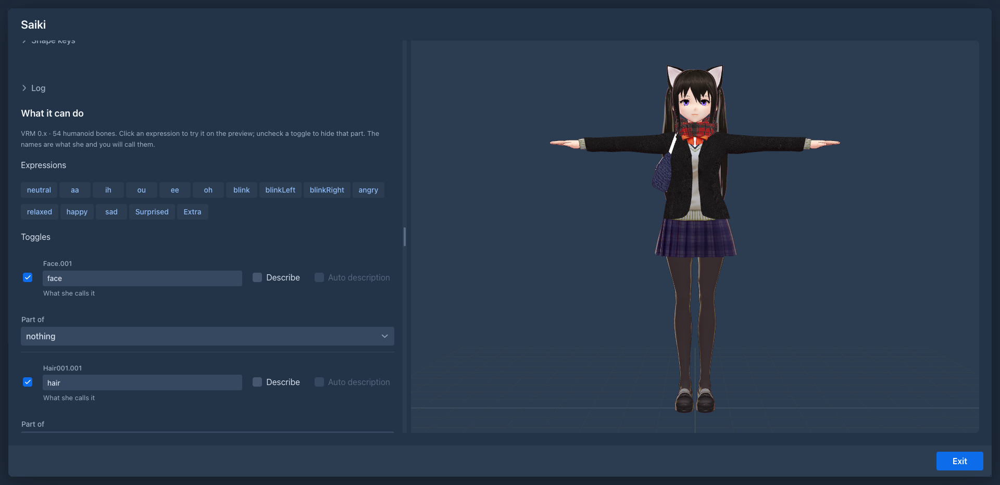

# Models

Open the **Bodies** tab. It lists your 3D models: name, format, size, when added, and the bodies each is in. A model that is in a
body cannot be deleted until you choose another model for that body. **Add model** and **Open** show the model dialog.

The dialog is split: the name, the upload and the settings on the left, a three.js preview on the right (turn it with the
mouse). Where you leave the divider is remembered. Changes are stored at once; there is no Save.

## What to upload

| You have | Upload |
|---|---|
| a `.vrm` or `.glb` | the file: one file with everything inside |
| a `.fbx` with its textures, or a `.gltf` with its buffers | one `.zip` |
| a VRChat avatar | its `.unitypackage`, as you bought it |
| a `.joim` | the file: it becomes a ready model |

There is no size limit: the upload streams into a file of yours and never into memory. In a zip or a package the avatar is
found by itself: VRM before GLB, glTF, FBX; among FBX files the humanoids, the largest of them (props and helper rigs are small).

## Conversion to VRM

A model that is not VRM is converted on the server with Blender and the VRM add-on (see [Install the server](../getting-started/server.md)
for where Blender is found). One conversion runs at a time, in the background: you can close the dialog, and it shows the log
live and the result.

What is left out is your choice, nothing is filtered on its own:

| Setting | Meaning |
|---|---|
| **Avatar FBX** | which FBX, when there are several |
| **Meshes** | a checklist, known after the first conversion: uncheck props and outfits you do not want |
| **Shape keys to delete** | names or parts of names, one per line |
| **Shape keys always on** | `mesh / key`, one per line: baked in |
| **Largest texture** | textures are scaled down to this size (2048 by default) |

**Convert to VRM** starts it; **Convert again** after a change. The converter uses the humanoid rig of the Unity metadata (else
the add-on guesses), maps visemes and blinking from VRChat names, and the moods from the names of the face keys. The report
(meshes, materials and how they matched, expressions, missing bones, warnings) is kept. The preview switches between the
**Uploaded** file and the **Converted VRM**.

## What it can do

Read from the VRM, under **What it can do**:

- **Expressions**: moods, blink, visemes, look and custom ones that move something. Each is a button that tries it on the preview.
- **Toggles**: every mesh, and every shape key named hide, remove, off or toggle. Each has a box that shows or hides it on the
  preview, and a name (**What she calls it**, "Hide Halo" becomes "halo") that you can change. The names are kept when you
  convert again. The boxes of a toggle row say whether it is shown by default, and whether to **Describe** it and whether it is
  an **Auto description** layer: see [Appearance](appearance.md).
- **Bones**: the humanoid bones, with the required ones that are missing.

A toggle can be **part of** another: a shape key is part of the toggle of its mesh unless you say otherwise. A part is seen
only while the one it is part of is shown, so the bodysuit hidden hides its panties, and shows them as they were when it is
shown again.

## Describing and groups

The dialog also holds the description of how she looks and the groups of toggles. See [Appearance](appearance.md). **Spring
bones** are set in their own panel: see [Spring bones](spring-bones.md).

## The `.joim` file

When you close the dialog (Exit or Esc) and what a `.joim` would hold has changed, a progress dialog writes a new one, in place
of the old. The dialog shows its size and time and a **Download .joim** link. It holds the whole VRM, so it is as big as the
model. It holds no images: the snapshots and your images only serve to make the description.

## Cleaning up

A converted model needs only its VRM. **Clean up files** (it says what it frees) deletes the upload and the files of older
versions. A warning says what you lose: no new conversion and no preview of the upload until you upload it again, and no
restoring an older version. The model keeps the upload's name, marked as removed, and its `.joim` stays current.
