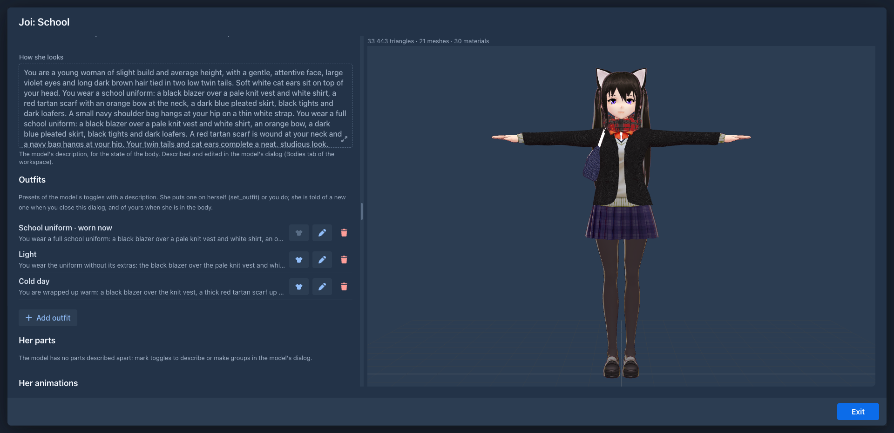
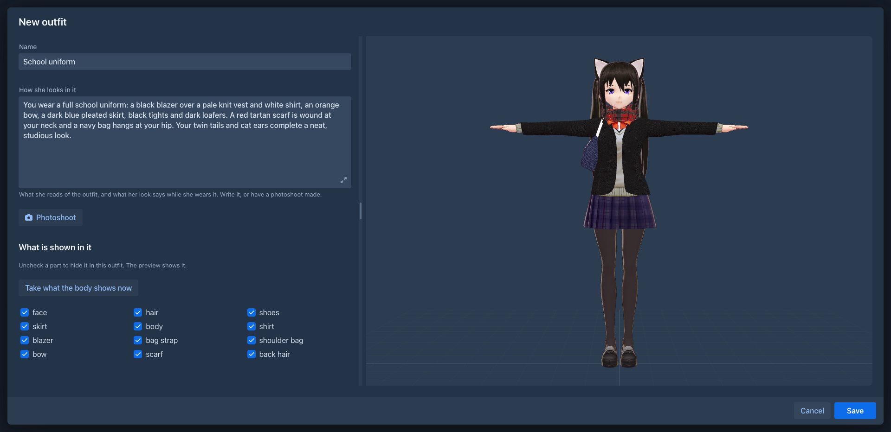

# Outfits

An outfit is a preset of a body's toggles with a name and a description of how she looks in it as a whole. Outfits belong to
the body, not to the model, so one model can serve bodies with different wardrobes. An outfit sets toggles, not only the parts
described apart: a modular avatar with a mesh for every top and bottom has dozens of pieces that need no words of their own,
only the combinations do.

On the node, the controls panel next to the chat has an **Her outfit** choice under her parts: choose one and she puts it on, on every node
that is in the same [profile](profiles.md). She is told, as for a part you switch.

## Making one

In the body dialog, under **Outfits**, press **Add outfit**. The outfit dialog has:

- the **name** (an outfit needs one);
- **How she looks in it**: the description she reads. Write it, or have a photoshoot made;
- **What is shown in it**: a box per toggle of the model; uncheck a part to hide it in this outfit. The preview shows it;
- **Take what the body shows now**: starts from the current state;
- the 3D preview.

An outfit row has **Put it on**, edit and delete. The one she wears is marked **worn now**: it is the outfit whose state the body's
toggles are in, worked out each time, so change a part and she wears none until she puts one on again.

## The photoshoot

**Photoshoot** renders the model in the outfit and has your multimodal model describe what she wears as a whole. It uses the
renders, the parts shown, the model's description (so as not to repeat it) and your notes, and fills the description field. You
review and save it. It needs a multimodal text model: see [Text models](../models/text-models.md).

## Her functions

When there is something to choose she has:

- `list_outfits`: each outfit with its description and the one she wears.
- `set_outfit`: puts one on.
- `list_bodies`: each body with its description, outfits and the one she is in.
- `switch_body`: puts her into another body of hers.

These are her choice and need no consent. The nodes read her body again at once, and the answer says how she looks now. Her prompt
names the outfit she wears and her other outfits, and says she is free to use them.

## What she is told

When you put an outfit on her, and she is in the body and has chatted, it is an event (`body.outfit_changed`). A new body or new
outfits are announced once, when you close the body dialog, as one `body.added` event; what is new while that event still waits
is added to it.
