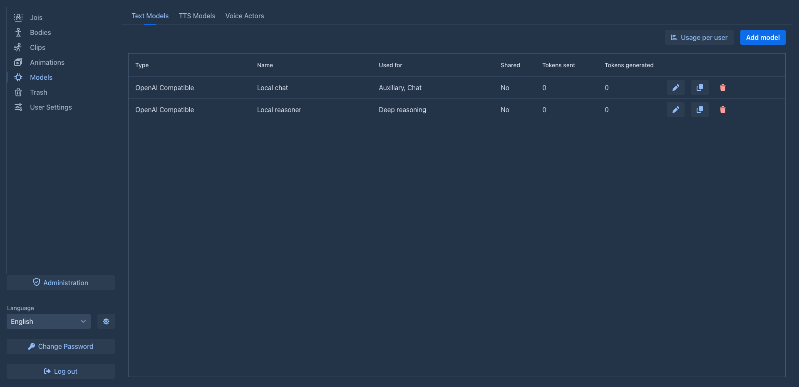
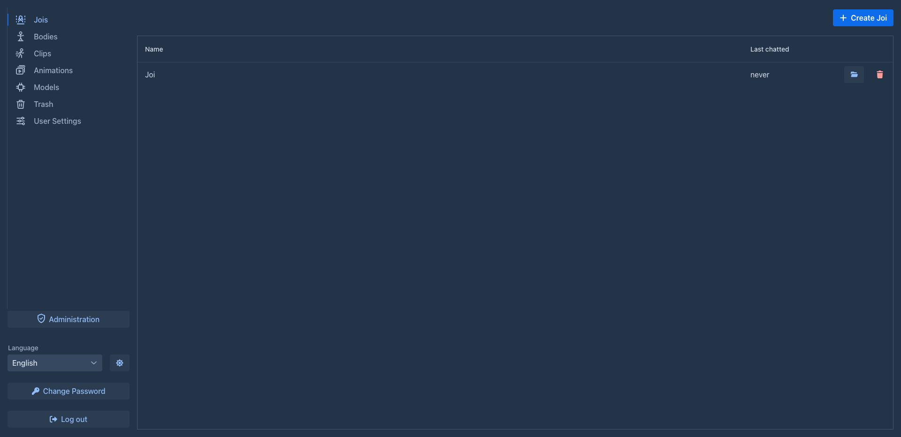
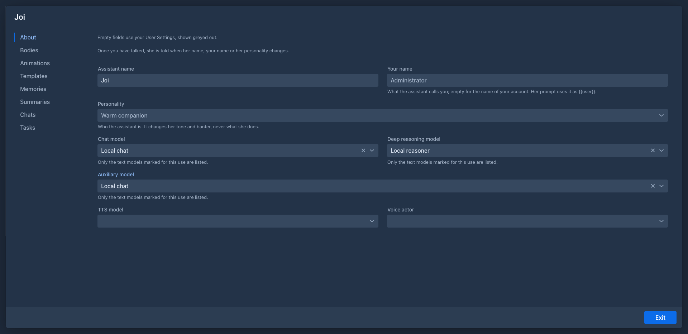

# Your first assistant

An assistant needs a text model to think with. Add one, create her, and choose the models she uses.

## 1. Add a text model

Open the **Models** tab, then **Text Models**, and press **Add model**.

Fill in the name, the address of your model server (an OpenAI compatible address that ends with `/v1`), the key if it needs
one, and the model's id. Under **Used for** mark what Joi may use the model for: **Chat** (the conversation), **Deep
reasoning** (long tasks, tool loops, describing a body) or **Auxiliary** (small background jobs). One model can do several.
Press **Test Connection** to check it. All of this is explained in [Text models](../models/text-models.md).

## 2. Create her

Open the **Jois** tab and press **Create Joi**. It asks for a name, prefilled with the assistant name of your User Settings
(else *Joi*). She appears in the list.

Press **Open** on her row. Her dialog has tabs on the left: About, Bodies, Animations, Templates, Memories, Summaries, Chats and
Tasks. Each change is stored at once; **Exit** closes the dialog.

## 3. Choose her models

On the **About** tab pick her **Chat model** and, if you have one, a **Deep reasoning model** and an **Auxiliary model**. An
empty field uses your [User Settings](../settings.md), shown greyed out, so if you set your models there once, every new
assistant already has them.

If you have a speech model and a voice actor, choose them here too (see [Speech](../models/speech.md)).

## 4. Talk to her

You talk to her in a [node](../node/index.md). Continue with [Your first node](first-node.md). Her conversation is also shown
read only in the **Chats** tab of her dialog (see [Chats](../jois/chats.md)).
