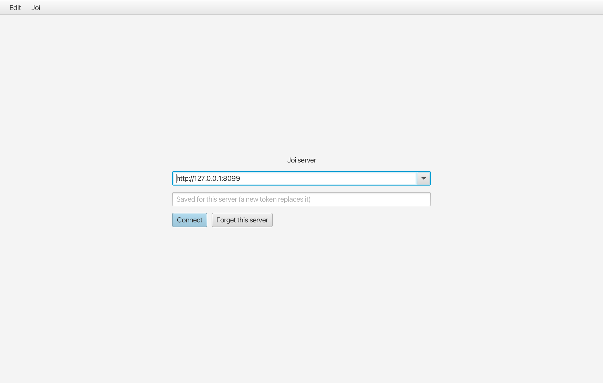

# Your first node

A node is the program on your machine where she appears and where you talk to her. The JavaFX node shows her body next to a
chat and plays her voice. See [The JavaFX node](../node/javafx.md) for all of it.

## Start it

From the source tree (JDK 25 or newer; OpenJFX and the embedded Chromium are fetched by the build):

```bash
mvn -Pfx compile exec:exec@run -pl joi-node
```

The node keeps its settings in `~/.joi-client` (or the folder named by `JOI_CLIENT`).

## Connect to the server

The first screen asks for the server's address, as `http://host:8080`. A server you connected to before is offered in the
list, the last one first. Press **Connect**.



How the node signs in depends on the server:

- On a development server (`mvn jetty:run`) with no authentication it needs nothing.
- Otherwise it pairs by the **device grant**: it shows a code like `WDJB-MJHT` and a link. Open the link in the server's UI
  after you sign in, or open **User Settings → Access → Connect a device** and type the code, then press **Approve**. The
  node goes on by itself.
- Or it asks for a **token**: make one in **User Settings → Access → Create token** and paste it. See
  [Access tokens](../access.md).

The server and its pairing are remembered. **Forget this server** (in the Joi menu) removes them.

## Choose her

The node lists your assistants under *Who?*. Pick one and press **Open**. It remembers the last one and goes straight to her
next time.

While her body downloads the node shows what it is doing (downloading, unpacking, starting her renderer). The files are
kept by hash in `~/.joi-client/cache`, so the next start is quick.

## The first greeting

When an assistant has never talked, she wakes up for the first time: the node shows her asleep (the animation you chose in her
Animations tab), the server starts her first turn, and when it is ready she plays her waking-up animation and speaks. She
says what she can do and what she thinks of her body. After that, whenever you come back she greets you in a way that fits how
long you were away.

Type in the chat to answer her. Her voice plays when she has a speech model.
