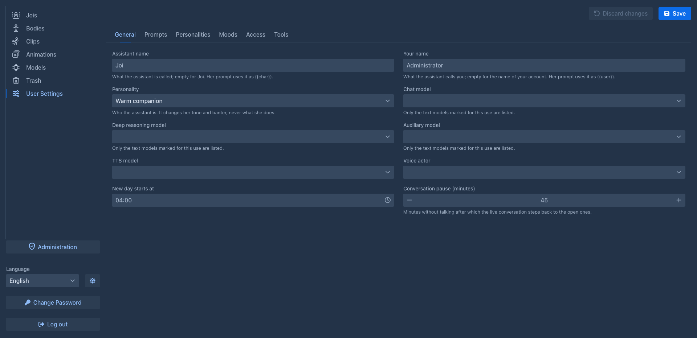

# First start

Open the server's address in a browser. On a new installation the first visit asks for the administrator account: a user
name, your full name and a password (twice). The account is an administrator, which is what lets you open the
[Administration](../administration/index.md) page later.

After that the login page takes over. Sign in with the account you made.

## The workspace

After the login you are in the workspace: a list of tabs on the left and the open tab on the right. Your layout (the open tab
and what you were doing) is remembered.

| Tab | What it holds |
|---|---|
| **Jois** | your assistants: create, open and delete them. See [Assistants](../jois/index.md) |
| **Bodies** | your 3D models. See [Models](../bodies/models.md) |
| **Clips** | the library of animation clips. See [Clips](../animations/clips.md) |
| **Animations** | what she plays, made of clips. See [Animations of an assistant](../animations/animations.md) |
| **Models** | text models, TTS models and voice actors. See [Models and voices](../models/index.md) |
| **Trash** | what you deleted, until you delete it for good. See [Trash](../trash.md) |
| **User Settings** | your defaults, prompts, personalities, moods, access tokens and tools. See [User settings](../settings.md) |

Below the tabs are the **Administration** button (administrators only), the language, the theme button, **Change Password**
and **Log out**.

Each tab keeps its changes as you make them, except User Settings, which has a Save button.

## Next

[Your first assistant](first-assistant.md).
