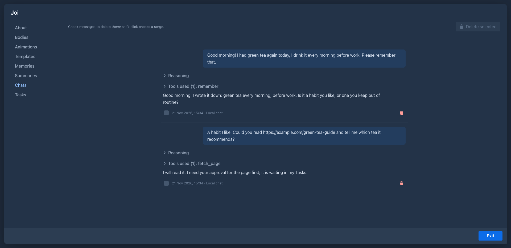

# Chats

The **Chats** tab of her dialog shows the conversation as a transcript, oldest at the top. You talk to her in a
[node](../node/index.md); this tab is where you read it back and clean it up.

## What a card shows

- **What you said** on the right, or an **event** in the middle with its kind (a part of her was switched, a task finished;
  see [Events](events.md)).
- **Her reasoning**, folded, when the model thought.
- **Her reply** as formatted text, with when it was said, which model answered and which node it came through.
- **Tools used (3): ...**, folded: every tool she used in the reply, in the order it happened, with the arguments she wrote and
  what it answered. A failed call is marked.
- A **play button** when the reply was spoken: the pieces of speech are joined into one clip kept on the message.
- **Notes** of the system (for example *approved automatically*): these are for you. She is
  never given them, they do not count as a conversation, and they are not in her summaries.

## Reading and loading

The tab opens at the latest 30 messages at the bottom. Scroll to the top and the 30 before them load, with what you were reading
kept in place. Nothing is dropped.

The tab follows the conversation while it is open: a message you just sent shows dimmed ("waiting for her reply") and is
replaced by the exchange when her reply is stored. The turns of one assistant run one at a time.

## Deleting

A message has a trash button. Or check messages and delete them together; shift-click checks a range. A deleted message is
gone from what she is shown next time: the prompt is built from the stored history on every turn.

## What she is shown

Each turn she gets her system prompt, the latest messages of the history, and, in front of a message after a pause or on a
new day, a line with the date and time it was said. She is told the time that way and not in the system prompt, so the
prompt stays the same from turn to turn and the model can reuse its work on it.
