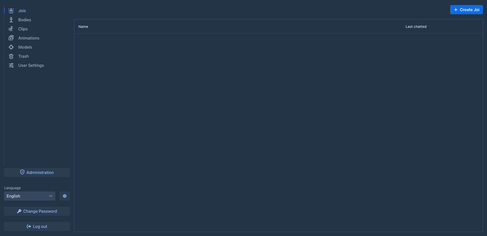
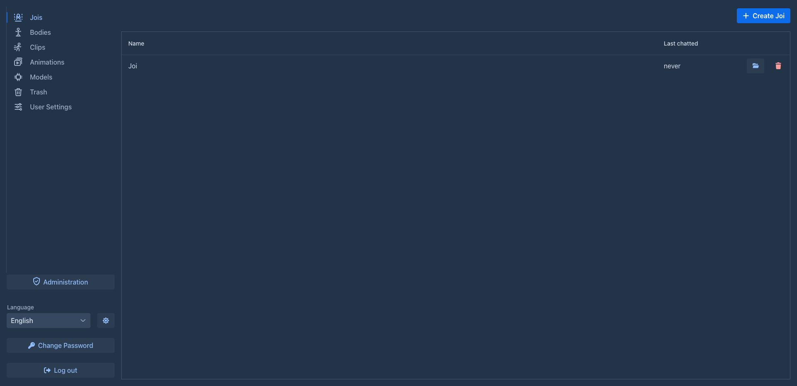

# Assistants

An assistant (a "Joi") is one character with her own name, personality, memory, conversation, models, voice and bodies. You can
make as many as you like: a home assistant and a work assistant, say. Each one is separate; they share only what is yours
(your models, your model files and clips, your User Settings).

## The Jois tab

The first tab of the workspace lists your assistants with their name and when you last chatted with them.

- **Create Joi** asks for a name, prefilled with the assistant name of your [User Settings](../settings.md), and makes her.
- **Open** shows her dialog. **Delete** moves her to the [Trash](../trash.md).

## Her dialog

Tabs on the left; every change is stored at once; **Exit** closes the dialog.

| Tab | What it is for |
|---|---|
| **About** | her name, what she calls you, her personality, her models, her voice. See [Persona and personality](persona.md) |
| **Bodies** | the bodies she can be in. See [Bodies of an assistant](../bodies/bodies.md) |
| **Animations** | what she plays asleep, falling asleep, waking up, idle and talking. See [Animations of an assistant](../animations/animations.md) |
| **Templates** | her prompts. See [Persona and personality](persona.md) |
| **Memories** | what she remembers. See [Memory](memory.md) |
| **Summaries** | what she remembers of the past, newest first. See [Summaries](summaries.md) |
| **Chats** | her conversation as a transcript. See [Chats](chats.md) |
| **Tasks** | what she started with her tools and what waits for your answer. See [Tasks and approvals](tasks.md) |
| **Files** | her [workspace](../tools/workspace.md): the files she keeps and her tasks write; you can browse, read, upload, download and delete |

## What is shared and what is hers

Most settings follow one chain: **her own value, then your User Settings, then the built-in default**. An empty field in
her dialog means "use mine", and shows what that is, greyed out. So you set things once in User Settings and change them for
one assistant only where she should differ: her name, her personality, her models, her voice, her prompts, her moods.

Per assistant: her conversation, memories, tasks, bodies, her choice of animations, and her permission for server tools.
Shared by all of yours: text models, TTS models, voice actors, 3D models, clips and animations (the library), and the
prompts and personalities in User Settings.
