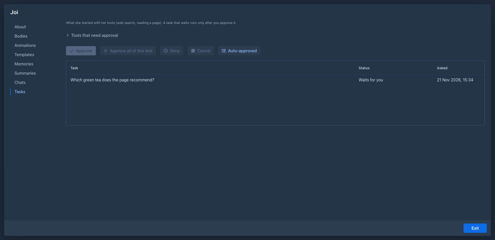

# Tasks and approvals

Some of her tools do not answer at once: searching the web or reading a page is a **task**. She starts it, says she is on it, and
the task runs after her reply on the stronger model (her deep reasoning model, else the chat model). When it ends she tells you
the result in her own words.

## The Tasks tab

The **Tasks** tab of her dialog lists what she started, newest first: the task, its status and when it was asked. Click one to
see what she asked for, the page, the result or the error, and the transcript: every step of the model, what it was told,
which tool it called, how long it took and its tokens.

| Status | Meaning |
|---|---|
| **Queued** | waits until her reply is finished, spoken included |
| **Waits for you** | needs your approval |
| **Running** | in progress |
| **Done**, **Failed**, **Cancelled** | ended; a task you denied is shown as cancelled with your reason |

Her own permission for each tool is also set on this tab (Inherit, Allow, Ask, Deny: see [Permissions](../tools/permissions.md)),
and **Auto-approved** lists the tools you approved ahead of time.

## Approving

A task of a tool that asks **waits for you**. You can answer:

- **Approve**: this task runs.
- **Approve all of this tool**: this one and every later one of the tool run without asking. This is the standing approval; it
  is listed under **Auto-approved**, where **Ask again** takes it back. A tool set to Deny still never runs.
- **Deny**, with a reason (**Why not**): she is told and says so.
- **Cancel**, for a task that is queued or running: she is told.

Every approval, denial, cancel and standing approval leaves a note in the conversation.

## Where the question appears

The same question is asked in several places, and the first answer wins; the others take the question back:

- the **Tasks** tab of her dialog;
- the [JavaFX node](../node/javafx.md): a dialog with Approve, Approve all of this tool, Deny and Later;
- the [terminal node](../node/terminal.md): `/yes`, `/always`, `/no [reason]`;
- the HTTP API, for your own clients.

A node that does not answer leaves the task waiting, and the dialog still answers it.
