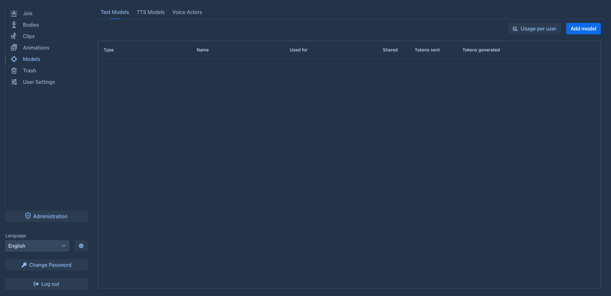

# Models and voices

The **Models** tab holds everything that thinks or speaks for her. It has three tabs.

| Tab | What it holds |
|---|---|
| **Text Models** | the models she thinks with. See [Text models](text-models.md) |
| **TTS Models** | the speech servers she talks through |
| **Voice Actors** | the voices. See [Speech](speech.md) |

Models belong to the user who adds them. An administrator can mark a text model **Shared with all users**.

## Model roles

An assistant uses up to three text models, one for each role:

- **Chat model**: the conversation. It should answer fast, because speech waits for it. It plays her persona and mood and calls
  simple tools.
- **Deep reasoning model**: the stronger one, for long work. The tasks she starts run on it after her reply: searching the web
  or reading a page for her. It also describes bodies and outfits from pictures when it takes images.
- **Auxiliary model**: small background jobs.

Each model is marked for the roles it may fill (**Used for**), and a role lists only the models marked for it. If an
assistant has no deep reasoning model, the chat model does the work of that role.

Where a role is chosen, as with every setting, the chain is: the assistant's own choice, then your User Settings, then the
built-in default. See [User settings](../settings.md).

## Per-user usage

**Usage per user** (on the Text Models tab) shows the tokens sent and generated.
