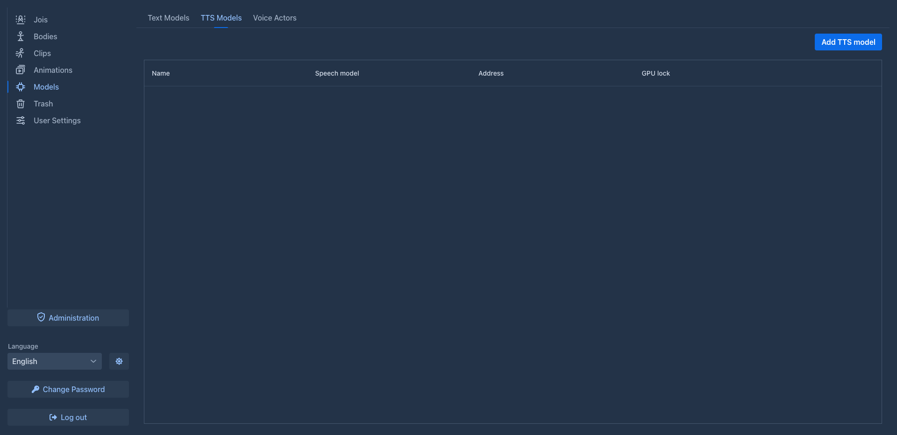
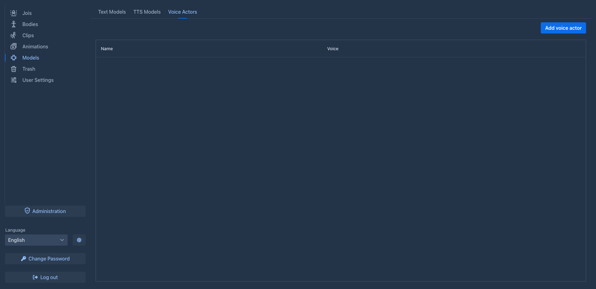

# Speech

She speaks through a speech server of yours. The server renders speech in pieces: the first sentence of a reply is rendered
alone so it plays soon, and the next piece renders while the one before plays. Speech needs a **TTS model** and a **voice
actor**.

## A TTS model

Open **Models → TTS Models** and press **Add TTS model**. A TTS model is one speech server.

| Field | Meaning |
|---|---|
| **TTS model** | the kind: *Chatterbox Turbo* (English, sound tags), *Chatterbox* (English, exaggeration), *Chatterbox Multilingual* (23 languages) or *Higgs Audio v3 in ComfyUI* (emotions and sounds; its license is non-commercial) |
| **Address** | the base address: Chatterbox-TTS-Server (for example `http://localhost:8004`) or ComfyUI (`http://localhost:8188`) |
| **The server is on this machine or on my network** | allows local addresses; leave it off for a server in the cloud. Shown to a user who is not an administrator only when Administration → **App settings** allows it |
| **Speech model** | the model the server must have loaded |
| **GPU lock** | the lock of the GPU the server runs on; every request waits its turn and the lock's start-up steps load the server first |
| **Timeout**, **Audio format**, **Speed**, **CFG weight**, **Chunk size** | speech defaults |
| **Precision** (Higgs) | fp32 is the safe choice |

**Test Connection** takes the GPU lock and asks the server whether the model is loaded. Nothing is spoken.

## A voice actor

Open **Voice Actors** and press **Add voice actor**. A voice actor is a voice plus a description.

- **Voice**: a reference clip (one of your audio resources, or a new upload: a WAV or MP3 of up to 20 MB) or a voice file of the speech server.
- **A voice for a mood or a language**: add more voices for a mood (a whisper, a shout) or a language (a clip that speaks
  Japanese). The language wins over the mood; without a voice for them the main voice speaks.
- **Description**: how the voice sounds, in words ("low and warm, a little husky"). She reads it: it is in her prompt, and she is
  told when it becomes her voice.
- **Try the voice** speaks a sample text with the model you pick.

## Giving her the voice

On her **About** tab (or your User Settings) choose the **TTS model** and the **Voice actor**. Her mood chooses the actor's voice
for that mood, and for Higgs the emotion of the reply.

Her speech plays in the node. When a reply was spoken, the pieces are joined into one clip kept on the message: the message in
her [Chats](../jois/chats.md) tab then has a play button.
