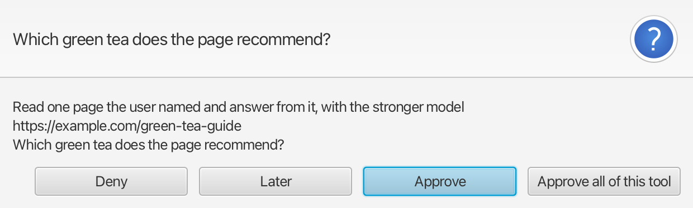

# Answering her questions

A task of hers that needs your approval (see [Tasks and approvals](../jois/tasks.md)) is also asked to you on every node that is
connected. The first answer, from anywhere, wins: the others take the question back.

## The JavaFX node

A dialog shows the title of the task, the tool and what it does, what she asked for and the page. Press:

- **Approve**: this task runs.
- **Approve all of this tool**: this one and every later one of the tool run without asking.
- **Deny**: you can say why; she is told.
- **Later**: close the dialog and leave it waiting. The **Tasks** tab of her dialog in the server still answers it.

A notification she asks to show (see [Notifications](notifications.md)) is asked about in a dialog too: **She wants to notify you**,
with **Allow** and Deny. A text she offers for the clipboard (see [Clipboard offers](clipboard.md)) is asked about in a dialog that shows it:
**Copy** or Don't copy. A file she reads outside your folders, a file she writes and a command she runs (see [Files and shell](harness.md)) are asked about with **Allow once**, **Allow for session** and **Deny**.

## The list of auto-approved tools

**Joi → Auto-approved tools…** shows the tools you approved ahead of time (*Tasks of these tools run without asking*), each with
**Ask again** to take it back. When none is approved it says *No tool is approved ahead of time*.

## The terminal node

The question is printed. Answer the oldest with `/yes`, `/always` (the tool from now on) or `/no [reason]`. `/tasks` lists her
tasks, `/auto` the standing approvals, `/auto on <tool>` and `/auto off <tool>` change them.

## Your own client

A client of the HTTP API gets the same questions as `task` frames on the node WebSocket and answers with `approve`, `approve`
with `always`, or `deny`. See [The protocol](../../developer/protocol.md).
