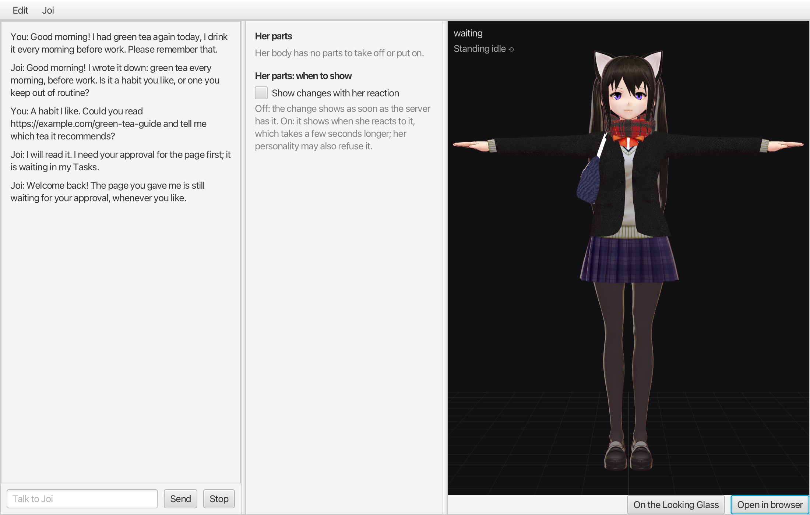

# The JavaFX node

The JavaFX node is a desktop app. It needs JDK 25 or newer; the build fetches OpenJFX and an embedded Chromium that draws her body.

```bash
mvn -Pfx compile exec:exec@run -pl joi-node
```

Settings are in the node's home, `~/.joi-client` (`--joi-home-dir <folder>` or `JOI_HOME_DIR` name another one; `JOI_CLIENT` is the old name of the variable): `node.json` holds the node's id, name, the server and the assistant
chosen last, and `credentials.json` holds the credentials for each server, readable by you alone. Her body is cached in
`cache`.

## The screens

1. **The server.** The address as `http://host:8080` (a list of the servers you used before, the last first), a field for a token
   (leave it empty to pair), **Connect** and **Forget this server**. See [Your first node](../getting-started/first-node.md).
2. **Pair this node**, when pairing: the code and where to enter it.
3. **Who?** your assistants, and **Open**. The one chosen last is opened straight away while she exists.
4. **Loading**: her body downloads (checked by hash before it is kept), unpacks, and her renderer starts.
5. **Her**: the chat next to her body.

## Her screen



- **Her body** is drawn by the embedded Chromium. A line shows her state (waiting, talking, asleep...) and the animation that
  plays. **Open in browser** shows the same page in your browser.
- **The chat** starts with her history from the server, so a conversation goes on where it was. Type, press **Send**; **Stop**
  interrupts her. Her reply streams in; when she has a voice, the text of a reply waits for its first piece of speech so the
  chat does not run ahead of her. Her voice plays as it arrives.
- **The controls** panel between the chat and her body (see below).
- **On the Looking Glass** moves her onto a Looking Glass display: see [The Looking Glass](looking-glass.md).
- Messages of the system show as notes in the chat.

When she waits she plays one of her idle animations, another each time; while she speaks, one of her talking ones. She plays
the animation she picks herself once on top.

### Her parts


**Her parts** in the controls panel has a box for a part that is shown or hidden, or a choice for a group's states. Your changes are
held back until you leave the parts alone for about four seconds, then sent together, and the controls are locked until the server
answers. The server keeps the state on her body, so it is the same on every node and at the next start, and she is told.

If you typed words in the chat input when the change is about to be sent, the node asks **Send your message with the change?**:
**Send together** sends your message with the change as one thing to her, **Change only** sends just the change.

If her personality gives her a say in it, she may refuse a change: the control goes back to how it was.

**Her parts: when to show** is the checkbox **Show changes with her reaction**. Off, the change shows as soon as the server has it.
On, it shows when she reacts to it.

If her body has no parts to take off or put on, the panel says so. A change made in the server's UI shows on the node as she is
read again by it.

## The menus

| Menu | Items |
|---|---|
| **Edit** | Cut, Copy, Paste, Select all |
| **Joi** | **Auto-approved tools…** (see [Answering her questions](approvals.md)) and **Notifications** (see [Notifications](notifications.md)) |

## While she is away from the server

When the connection is lost the chat and controls are disabled, she is frozen and gray, and a bar says when the next try is, with
**Reconnect now**. When it is back she goes on.
