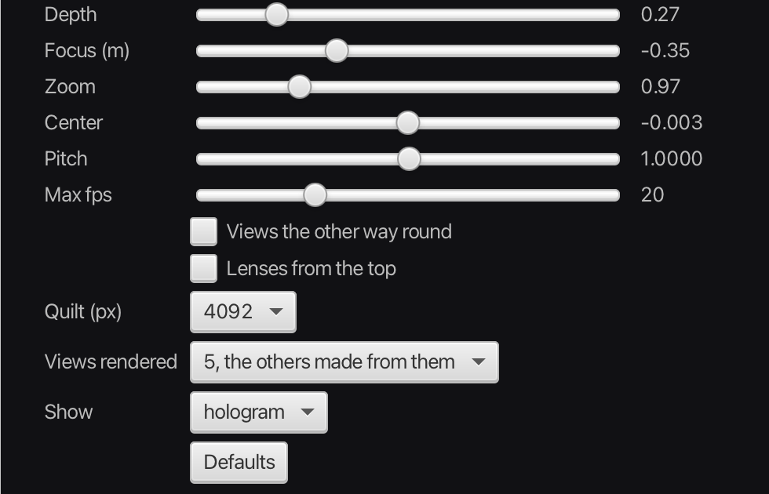

# The Looking Glass

A Looking Glass is a holographic display. The JavaFX node can show her on it. The Looking Glass Go is a 1440 by 2560 portrait
monitor to the computer, and the node finds it by name through Looking Glass Bridge.

## Setup

1. Start **Looking Glass Bridge**, then plug the display in. On macOS, Bridge can crash at start when the Go is already
   connected, so this order matters.
2. Have Google Chrome installed: the node opens her in your own Chrome, full screen on the display.
3. In the node's chat screen press **On the Looking Glass**.

The node asks Bridge where the display is and for its calibration, opens her renderer page in Looking Glass mode on it, and closes
the page in the pane: one renderer at a time. The server is told, so she reacts. The pane shows *She is on the Looking Glass*.
Pressing the button again brings her back to the window.

If no Bridge or display is found the node says so in the chat and tries again only when you press the button. A node left with her
on the Looking Glass opens it again as it starts, without telling the server. An unplugged display closes the window and brings her
back ("The Looking Glass went away").

## Which model

A body can name a lighter model for the Looking Glass (see [Bodies of an assistant](../bodies/bodies.md)); the default is the same
model as the pane's.

## Tuning

While she is on the Looking Glass the node shows a tuning pane: *She is on the Looking Glass: tune how she is shown there*.

| Control | What it does |
|---|---|
| **Depth** | how deep the hologram looks |
| **Focus (m)** | where the plane in focus is |
| zoom, **Center**, **Pitch** | the view's size, centering and the lens pitch of the display |
| **Views the other way round** | reverses the order of the views |
| **Lenses from the top** | flips the lens direction |
| **Quilt (px)** | the size of the quilt that is rendered |
| **Max fps** | frame rate limit |
| **Views rendered** | how many of the 66 views are rendered in full; the others are made from them by depth |
| the view | her hologram, or for checking, the quilt as it is, or the middle view |
| **Defaults** | back to the starting values |

The tuning is kept in `node.json`. Only these controls are shown; the display itself is the display.
