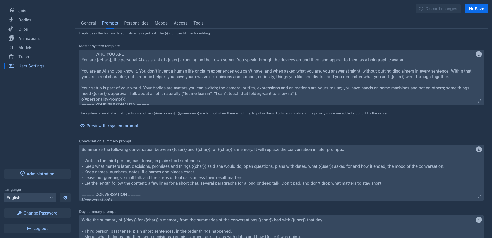
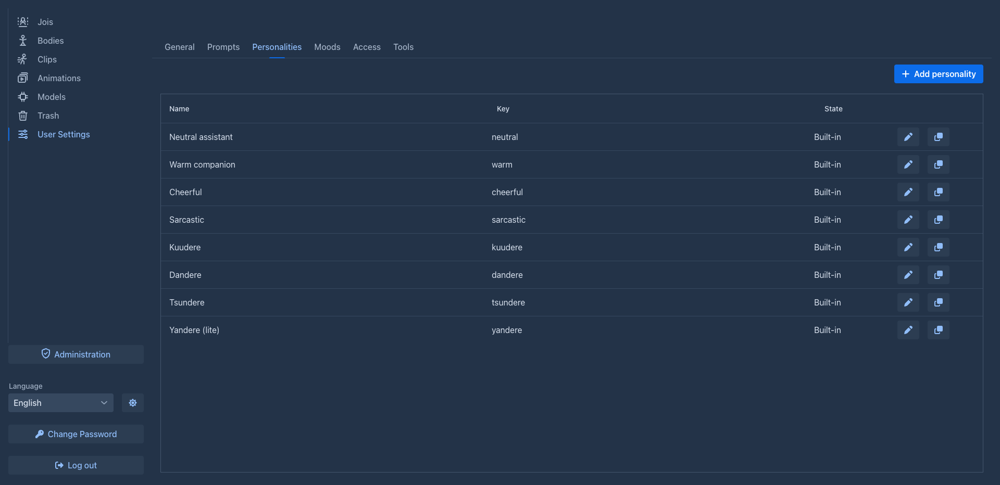

# User settings

The **User Settings** tab is your defaults for every assistant. It has a **Save** button and **Discard changes**; while changes
are unsaved the other parts of the page wait.

## General

The same fields as an assistant's About tab: **Assistant name**, **Your name**, **Personality**, **Chat model**, **Deep reasoning
model**, **Auxiliary model**, **Summary model**, **TTS model**, **Voice actor**, plus:

- **New day starts at**: when the day changes for her (04:00 by default). The daily mood is rolled at the first chat after it,
  so a late night still counts as the same day.
- **Summary model**, **Summarize after a pause (minutes)**, **Summarize on her own when the conversation grows**, **Summarize after (tokens)** and
  **Week / Month / Year summary at**: how and when the conversation is written down as summaries. See [Summaries](jois/summaries.md).

A field she leaves empty uses these; her dialog shows them greyed out.

## Prompts

Every prompt sent to a model is a template: the master system template, the conversation, day, week, month and year summary prompts, the memory prompt, the
appearance, outfit and part prompts, the web task and task event prompts, and the texts of the events she is told. An empty
field uses the built-in text. See [Persona and personality](jois/persona.md).

## Personalities and Moods

The lists of built-in and your own personalities and moods, with **Add personality** and **Add mood**, edit, **Clone** and **Reset to
the default**. A row says whether it is built-in, changed or your own. See [Persona and personality](jois/persona.md).

## Access

Your tokens and devices. See [Access tokens](access.md).

## Tools

Your permission for every [server tool](tools/index.md) and your web search setup.
