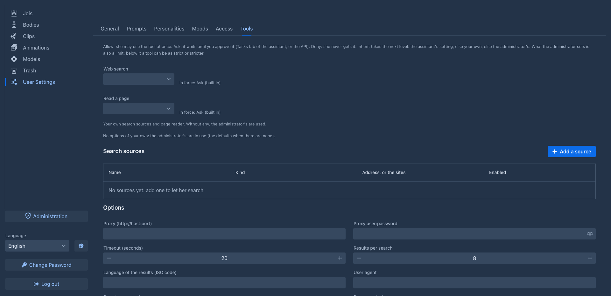

# Server tools

A **server tool** is a function the server itself gives her, as opposed to the tools a [node](../node/index.md) offers. The
server tools are `web_search` and `fetch_page`. Both start a [task](../jois/tasks.md): the tool answers at once ("searching, I
will tell you"), the task runs on her deep reasoning model after her reply, and she reports the result.

Whether she may use a tool, and who decides, is a **permission chain**: see [Permissions](permissions.md). The search sources and
how a page is read are set up in [Web search and pages](web-search.md). What a task writes for you as a file is in [Her workspace](workspace.md).

## Where the tools are listed

The same panel appears in three places:

| Place | Whose setting |
|---|---|
| **Administration → Tools** | the administrator's: for every user |
| **User Settings → Tools** | yours: for all your assistants |
| the **Tasks** tab of her dialog | hers alone |

Each tool is a row with its permission (Inherit, Allow, Ask, Deny) and the one in force, with where it comes from ("Ask (from the
administrator)"). A change is stored at once. The web search panel below the permissions has its own **Save**.

