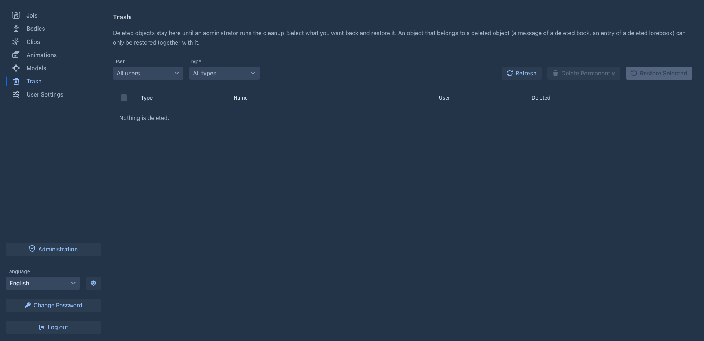

# Trash

What you delete (an assistant, a model, a body, a clip, a text model) goes to the **Trash** tab. It stays there until an
administrator runs the [cleanup](administration/index.md).

Select what you want back and press **Restore Selected**. An object that belongs to a deleted object (the body of a deleted
assistant) can only be restored with it: the page says which deleted object it needs, and nothing is restored until you select it
too.

A file Joi makes again from what it holds is never kept twice: the `.joim` or `.joia` that a new one replaces is deleted with its
file at once, not left in the trash.
